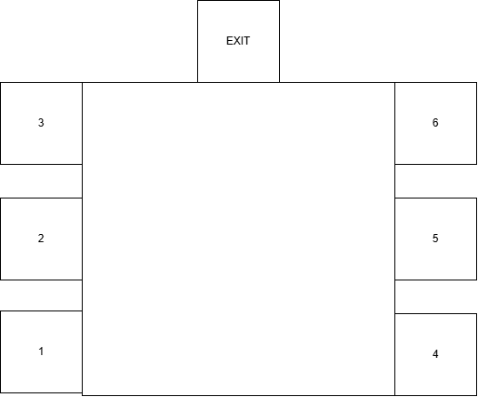
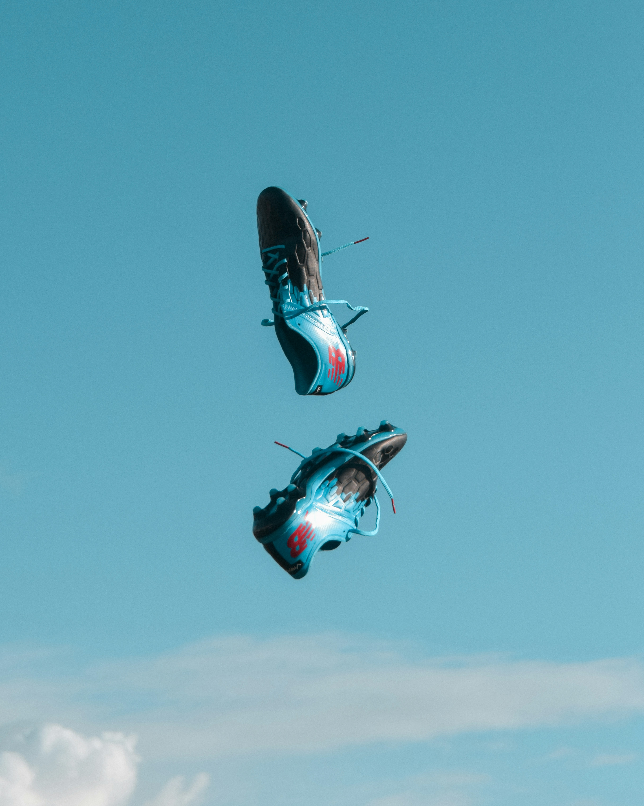

# SpeedStars

Projet conçu en équipe avec : Éric,Alexis,Nicholas
## Le public cible

- Pour qui : Athlètes, Sportifs, ceux qui aiment bouger
- Ce qui est important pour eux : Être en action, constamment bouger

## La conception

- L'intrigue :  
- Le nombre d'énigmes : 6
- Le type d'énigmes : Énigmes d'action comme test de rapidité 
- Les besoins matériels : Boutons, fournitures de décors, 
- Les besoins technologiques : Lumières, boutons réactifs, haut-parleur
- Les besoins humains : Guide. indices 
- Le plan des salles (croquis) :

## Les éléments importants

- Engagement sensoriel : Bruits rapides, musique motivante, 
- Conception spatiale : Lumières fortes et qui clignotent
- Rétroaction : Stress et de l'eau gratuit
- Technologie invisible : Fils, Haut-parleur, projecteurs

## Les risques et la sécurité

- Risque 1 : Devenir aveugle (solution : Porter des lunettes de protection)
- Risque 2 : Évanouir (solution : Être plus en forme)

## La promotion

- Stratégie 1 : Réseaux sociaux (car c'est populaire et une grande majorité des adolescents les utulisent)
- Stratégie 2 : Affiches (Car les gens sortent dehors tout les jours donc plus de visibilité)

## Les ressources

- Son d'ambiance : [titre du son](lien)
- Crédits :
    - « Titre de l'image », par ..., [Source](lien), [Licence](lien)
    - « Titre du son », par ..., [Source](lien), [Licence](lien)
